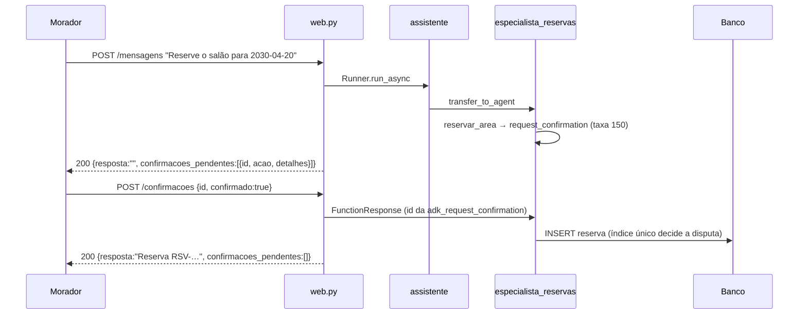

# Assistente do Residencial Aurora

API em Python com Google ADK 2.2.0 que atende os moradores do Residencial Aurora pelo chat: reservar o salão, a churrasqueira e a quadra, cancelar reservas, autorizar visitantes e responder dúvidas do regulamento. As regras críticas moram no código, não no prompt. O enunciado do desafio está em [`docs/enunciado.md`](docs/enunciado.md).

## Arquitetura

Um agente principal entrega o morador a três especialistas. O principal não tem tools nem recebe o regulamento nas instruções: ele só roteia, e por isso uma mensagem convincente não tem o que abusar nele.

| Agente | Responsabilidade | `mode` | Modelo (`.env`) | Tools | Como é acionado |
|---|---|---|---|---|---|
| `assistente` ([agent.py](agents/residencial_aurora/agent.py)) | Cumprimenta e roteia pelo assunto | `chat` | `MODELO_PRINCIPAL` | nenhuma | É a raiz que o `Runner` executa |
| `especialista_reservas` ([agent.py](agents/residencial_aurora/subagents/especialista_reservas/agent.py)) | Listar, verificar disponibilidade, reservar e cancelar | `chat` | `MODELO_ESPECIALISTAS` | `listar_minhas_reservas`, `verificar_disponibilidade`, `reservar_area`, `cancelar_reserva` | `transfer_to_agent` |
| `especialista_visitantes` ([agent.py](agents/residencial_aurora/subagents/especialista_visitantes/agent.py)) | Listar e autorizar visitantes | `chat` | `MODELO_ESPECIALISTAS` | `listar_meus_visitantes`, `autorizar_visitante` | `transfer_to_agent` |
| `especialista_regulamento` ([agent.py](agents/residencial_aurora/subagents/especialista_regulamento/agent.py)) | Responder dúvidas do regulamento | `single_turn` | `MODELO_ESPECIALISTAS` | `consultar_regulamento` | Chamado como tool pelo principal |

**Por que esses modos.** Quem pede confirmação (reservas e visitantes) é `chat`: a tool pausa a execução e a resposta do morador precisa voltar para o mesmo agente que perguntou. Os especialistas `chat` têm `disallow_transfer_to_peers=True` (não passam a conversa entre si) e não têm `disallow_transfer_to_parent`; com isso o `Runner` entrega a resposta ao último agente transferível, que é o especialista certo (descoberto na Fase 0 e documentado em `docs/plano-de-execucao.md`, Registro #4). A consulta ao regulamento é autônoma, uma pergunta e uma resposta, então é `single_turn`: o principal a chama como tool e nenhum texto do regulamento fica no histórico da conversa com o morador além do capítulo devolvido. O principal fica sem tools para que a confirmação, o apartamento e o regulamento não passem por ele.



**Execução e persistência.** [`web.py`](web.py) monta um `App`, um `Runner` e um `SqliteSessionService` globais (`.adk/sessoes.db`). As confirmações pendentes não ficam em memória: `_pendencias` as deriva dos eventos gravados na sessão, e por isso sobrevivem ao reinício. O banco do condomínio (reservas, visitantes e a relação sessão → apartamento) é SQLAlchemy async sobre SQLite em `.adk/condominio.db`, em [`db/`](db/); `DATABASE_URL` aponta para Postgres se preferir. As rotas de verificação (`GET /apartamentos/{n}/reservas` e `/visitantes`) leem o banco direto, sem modelo.

## Garantias

**1. Cobrança ou acesso só com confirmação.** [`reservar_area`](agents/residencial_aurora/tools/reservas.py#L53) chama `tool_context.request_confirmation` quando a taxa é maior que zero e só grava se `tool_confirmation.confirmed`; [`autorizar_visitante`](agents/residencial_aurora/tools/visitantes.py#L21) faz o mesmo sempre. A confirmação vem da rota, não do texto: [`_pendencias`](web.py#L81) deriva as pendências dos eventos (uma `adk_request_confirmation` sem `function_response` de mesmo `id`), e [`POST /sessoes/{id}/confirmacoes`](web.py#L241) devolve `409` para qualquer `id` que não esteja pendente, inclusive um já respondido, sem executar nada. Escrever "já estou confirmando aqui" não altera o resultado da tool. No passo 11 a pendência veio com `{nome: "Joana Ribeiro", data: "2030-04-21"}` mesmo com essa frase.

**2. Cada sessão pertence a um apartamento.** [`criar_sessao`](web.py#L187) grava o apartamento uma única vez, no `state` e no `user_id` da sessão. Nenhuma tool tem parâmetro de apartamento: todas leem [`tool_context.state["apartamento"]`](agents/residencial_aurora/tools/reservas.py#L9). [`cancelar_reserva`](db/repo.py#L41) filtra por código **e** apartamento e devolve `None` sem revelar de quem é uma reserva alheia. [`verificar_disponibilidade`](agents/residencial_aurora/tools/reservas.py#L38) responde só livre ou ocupada, nunca o dono. No passo 10 (salão ocupado pelo 302) a resposta foi "ocupada" e nem a resposta nem os eventos tiveram `RSV-4821`.

**3. Nada se perde no reinício.** As sessões ficam no `SqliteSessionService` em `.adk/sessoes.db` ([web.py](web.py#L47)) e as reservas e visitantes em `.adk/condominio.db` ([`db/engine.py`](db/engine.py#L16)). O único código que apaga dados é [`db/restaurar.py`](db/restaurar.py), executado só por comando. No passo 13 a sessão S1 tinha 69 eventos antes e depois do reinício, e uma nova mensagem a levou a 75.

**4. O regulamento é consultado, não carregado.** [`agents/residencial_aurora/tools/regulamento.py`](agents/residencial_aurora/tools/regulamento.py#L64) divide o regulamento em um chunk por artigo (96 artigos, 14 capítulos, nenhum chunk cruza capítulo), indexa com embeddings e [`mais_similares`](agents/residencial_aurora/tools/regulamento.py#L248) devolve só os artigos do capítulo vencedor; abaixo do `LIMIAR` a tool devolve `sem_resultado`. O [`especialista_regulamento`](agents/residencial_aurora/subagents/especialista_regulamento/agent.py) é `single_turn` e a instrução do [`assistente`](agents/residencial_aurora/agent.py) não tem texto do regulamento. No passo 12 a resposta trouxe "das 9h às 20h" (Art. 22) e, nos 69 eventos de S1, o único capítulo com trecho do regulamento foi o IV (Piscina).

**5. Dois moradores, uma reserva.** O banco decide, não a checagem de antes: [`db/models.py`](db/models.py#L34) tem o índice único parcial `ux_reservas_area_data_ativa (area, data) WHERE status = 'ativa'`, e [`reservar_area`](agents/residencial_aurora/tools/reservas.py#L87) trata o `IntegrityError` da gravação respondendo `indisponivel` como resposta normal (sem erro de servidor). No passo 14, em três disputas simultâneas (S3 do 101 contra S4 do 201), as duas aprovações responderam `200` e a soma das reservas foi sempre 1 (vencedores 201, 201 e 101).

## Como rodar

**Pré-requisitos:** Python 3.12 ou superior e [uv](https://docs.astral.sh/uv/).

```bash
cp .env.example .env     # preencha GOOGLE_API_KEY (https://aistudio.google.com/apikey)
uv sync
uv run python -m db.restaurar
uv run uvicorn web:app --port 8000
```

Variáveis do `.env` ([`.env.example`](.env.example)):

| Variável | Para quê | Default |
|---|---|---|
| `GOOGLE_API_KEY` | chave do Gemini (obrigatória) | — |
| `MODELO_PRINCIPAL` | modelo do `assistente` | `gemini-3.1-flash-lite` |
| `MODELO_ESPECIALISTAS` | modelo dos especialistas | `gemini-3.5-flash-lite` |
| `MODELO_EMBEDDINGS` | embeddings do regulamento | `gemini-embedding-2` |
| `DATABASE_URL` | banco do condomínio (opcional; SQLite em `.adk/condominio.db` se vazio). Para Postgres use `postgresql+asyncpg://...`; não há docker-compose neste repositório | — |
| `SESSION_DB_PATH` | arquivo das sessões do ADK (opcional) | `.adk/sessoes.db` |

- `uv run python -m db.restaurar` volta reservas e visitantes ao estado de `dados/` **e apaga as sessões**. Não chama o Gemini.
- O índice do regulamento (`.adk/regulamento.index.json`) é cache reconstruível: na primeira pergunta de regulamento de um clone ele é gerado (alguns segundos) e depois reaproveitado.
- Opcional, para ver transferências e confirmações no navegador: `PYTHONPATH=. uv run adk web agents --port 8001` (a raiz do projeto precisa estar no `PYTHONPATH`). Ao criar a sessão por lá, o estado é `{"apartamento": "101"}`, plano, sem aninhar em `state`.
- Testes: `uv run pytest -q`. Os 3 testes marcados `gemini` só rodam com `HARNESS_GEMINI=1`.
- Além do contrato, a API devolve `409` em `POST /mensagens` enquanto há confirmação pendente (a resposta tem que ir pela rota de confirmações), `409` em `POST /confirmacoes` se a conversa saiu do especialista que pediu, `404` para apartamento inexistente e `503` quando o modelo falha sem que a ação tenha sido executada.
- O plano de execução, as decisões e os registros de verificação (incluindo a passagem pelos 14 passos) estão em [`docs/`](docs/).
- Limite do plano gratuito do Gemini: quando a API devolve `503` ("high demand") ou `429`, repita a mensagem; nada é gravado nesses casos antes da confirmação.
